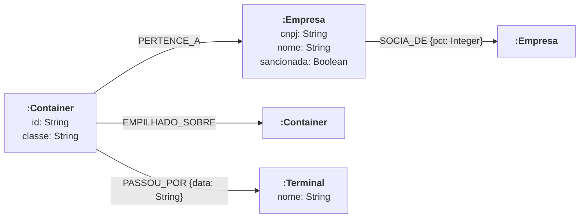
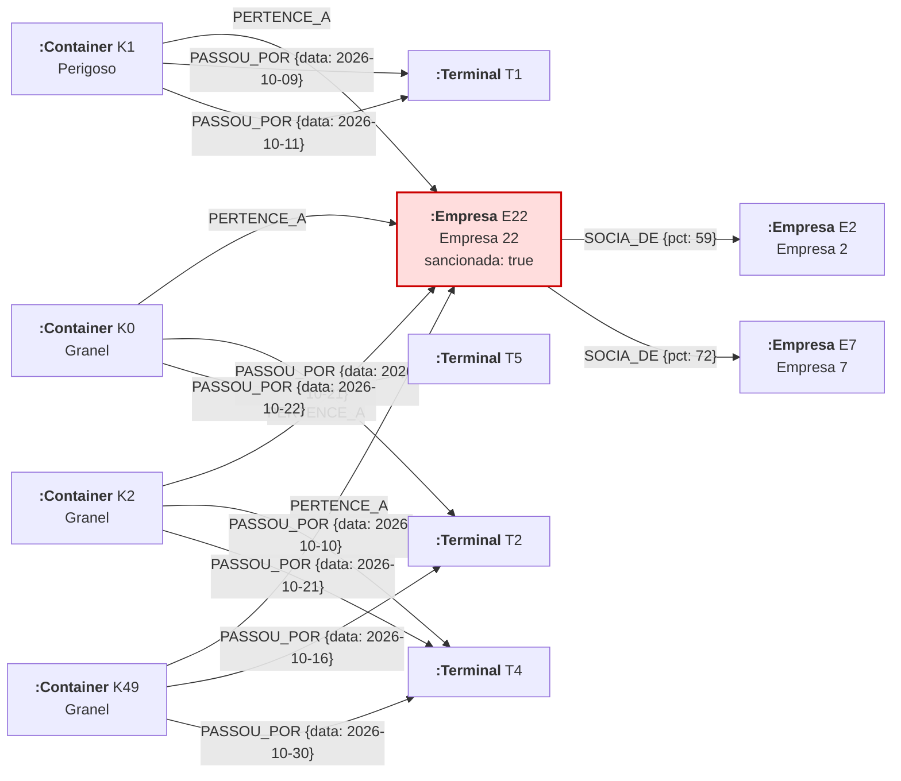

# C1 — Modelo do grafo

## Modelo (rótulos, relações, direções e propriedades)

**Legenda**

| elemento | significado |
|---|---|
| retângulo | nó, com o **rótulo** em negrito e as propriedades embaixo |
| seta | relação **com direção** (o Neo4j sempre grava a relação com direção) |
| `{...}` na seta | propriedade da **própria relação** |
| `(a:Empresa)-[:SOCIA_DE {pct}]->(b:Empresa)` | **a** tem `pct`% de **b** |
| `(k:Container)-[:PERTENCE_A]->(e:Empresa)` | o container **k** é da empresa **e** |
| `(k:Container)-[:PASSOU_POR {data}]->(t:Terminal)` | **k** passou pelo terminal **t** na data `data` (um container pode passar várias vezes) |
| `(a:Container)-[:EMPILHADO_SOBRE]->(b:Container)` | **a** está em cima de **b**, ou seja, quem está preso em cima da base aponta **para** ela |

Não tem chave estrangeira nem tabela associativa. A ligação entre empresa e empresa é uma relação de verdade, guardada junto dos nós, e o `pct` (que num banco relacional ficaria numa tabela `socios(de, para, pct)`) mora na própria aresta `SOCIA_DE`. O mesmo vale pra `data` em `PASSOU_POR`, que no relacional seria uma tabela associativa `passagens(container, terminal, data)`.

## Subgrafo real da EMPRESA_SANCIONADA (E22)

Consultado no meu Neo4j ([c1_subgrafo.cypher](c1_subgrafo.cypher) → [c1_subgrafo_saida.txt](c1_subgrafo_saida.txt)).

- **Sócios diretos:** a E22 é sócia da **E2 (59%)** e da **E7 (72%)**. Nenhuma empresa aponta pra E22, ou seja, ela não tem sócios acima dela.
- **Containers:** K0, K1 e K2 (forçados pelo gerador) e mais o K49. São 8 passagens no total. O K1 passou duas vezes no T1.
- **BASE_DA_PILHA K28:** só o `K29` aponta pra ele (`(K29)-[:EMPILHADO_SOBRE]->(K28)`), e o K28 não aponta pra ninguém, então ele é a base da pilha.
